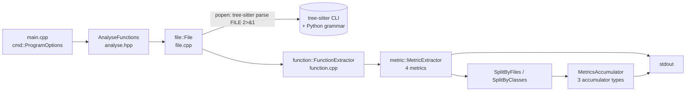

# cpp-middle-project4: documentation

`analyser` measures the functions and methods of Python source files. It runs the `tree-sitter` CLI on each file, cuts every function out of the printed syntax tree, and computes four metrics per function: lines of code, cyclomatic complexity, number of parameters and naming style. It then adds the results up per file and per class. It began as the sprint 4 project of the Yandex Practicum "Middle C++ developer" course (`README.md`, `LICENSE`). Users beyond the course are not named in the repository.

The requirements reverse-engineered from the code are in [`../SPEC.md`](../SPEC.md).

## Status

- Last commit touching the project's own code (`src`, `include`, `main.cpp`, `CMakeLists.txt`): `97185f5`, 2026-11-08, "refactor(core): settle the sources under clang-tidy and clang-format" (`git log`).
- Tests: 17 GoogleTest cases for the accumulators (`accumulator_tests`, in `ctest`) and 39 for the metrics (`metric_tests`, built but kept out of `ctest` because they start tree-sitter; `CMakeLists.txt:61-80`).
- CI: five Gitea workflows under `.gitea/workflows/`; `test.yaml` runs `.\recipe.ps1 test` and `.\recipe.ps1 build`. Whether a runner has executed them is not recorded in the repository (`CLAUDE.md`, "Branch protection starts at stage 1").
- Unfinished, as stated in the files: no gate builds or checks the `analyser` CLI (`docs/manual.md`, `docs/install.md`); `recipe.ps1 install` does nothing, "there is no installer yet" (`docs/install.md`); `tests/manual/tests.json` lists no manual tests; README lists ten exceptions to the lab requirements (issues #8-#17).

## Layout

| Path | What it is |
| --- | --- |
| `main.cpp` | CLI: registers the four metrics and four accumulators of three types, prints the results |
| `include/cmd_options.hpp`, `src/cmd_options.cpp` | `-f/--file` and `-h/--help` through Boost.Program_options |
| `include/analyse.hpp` | `AnalyseFunctions`, `SplitByFiles`, `SplitByClasses`, `AccumulateFunctionAnalysis` and their concepts |
| `include/file.hpp`, `src/file.cpp` | `file::File`: reads the source and the tree-sitter output through a pipe |
| `include/function.hpp`, `src/function.cpp` | `function::FunctionExtractor`: finds functions and their enclosing class in the tree text |
| `include/metric.hpp`, `src/metric.cpp` | `IMetric`, `MetricResult`, `MetricExtractor` |
| `include/metric_impl/`, `src/metric_impl/` | the four metrics |
| `include/metric_accumulator.hpp`, `src/metric_accumulator.cpp` | `IAccumulator`, `MetricsAccumulator` |
| `include/metric_accumulator_impl/`, `src/metric_accumulator_impl/` | the three accumulators |
| `include/utils.hpp` | `ToInt`, a checked `std::from_chars` wrapper |
| `src/*/tests/` | GoogleTest cases; `src/metric_impl/tests/files/*.py` are the ten Python fixtures |
| `files/` | three Python inputs used by `.vscode/launch.json` |
| `tree-sitter-sample.txt` | one line: a `tree-sitter parse` command, no parser output |
| `CMakeLists.txt` | targets `analyser_core`, `analyser`, `accumulator_tests`, `metric_tests` |
| `conanfile.py`, `CMakePresets.json`, `scripts/build_windows.ps1`, `.devcontainer/`, `.vscode/` | course-era build route; no gate runs them (`docs/install.md`) |

## Architecture



- `file::File` opens the file, runs `tree-sitter parse <file> 2>&1` (on POSIX with `--config-path /root/.config/tree-sitter/config.json`) and keeps the whole output as `ast` and the source as `source_lines` (`include/file.hpp:14-25`, `src/file.cpp:54-98`).
- `FunctionExtractor::Get` searches the text for `(function_definition`, cuts the balanced-parentheses span, reads the name from the source at the first `(identifier` coordinates, and finds the enclosing `(class_definition` by row/column range (`src/function.cpp:31-172`).
- Each metric works on the function's tree text, not on a parsed tree object (`src/metric_impl/*.cpp`).
- `MetricsAccumulator` routes every `MetricResult` to the accumulator registered under the same metric name (`src/metric_accumulator.cpp:28-32`).
- External dependency at run time: the `tree-sitter` CLI and a Python grammar it can find (`docs/install.md`). Nothing is written to disk; output goes to stdout and stderr.

## Build and run

Prerequisites (core and tests): g++ 13 or newer, CMake 3.28 or newer, Ninja, LLVM for `clang-tidy` and `clang-format` (`docs/install.md`, `CMakeLists.txt:1`). `recipe.ps1` adds `C:\ProgramData\mingw64\mingw64\bin` and `C:\Program Files\LLVM\bin` to its PATH (`recipe.ps1:52-54`). The first configure downloads GoogleTest v1.13.0, pinned by SHA256 (`CMakeLists.txt:51-56`).

| Command | What it does | Source |
| --- | --- | --- |
| `.\recipe.ps1 build` | configure with g++, Ninja, Release, `-DANALYSER_CLI=OFF`; build `analyser_core` and both test binaries into `build\` | `recipe.ps1:56-62,89-92` |
| `.\recipe.ps1 test` | build, `ctest`, `clang-tidy`, `clang-format -i`, lock and exception word checks | `recipe.ps1:130-147` |
| `.\recipe.ps1 run [gtest flags]` | build, then run `build\metric_tests.exe` from `build\` (needs tree-sitter) | `recipe.ps1:101-110` |

The CLI needs Boost.Program_options and `<print>` (g++ 14 or newer); `recipe.ps1` does not build it (`docs/install.md`):

```powershell
cmake -S . -B build-cli -G Ninja -DCMAKE_BUILD_TYPE=Release -DBUILD_TESTING=OFF
cmake --build build-cli
```

Course-era route, not run by any gate: `conan install . --build=missing --settings=build_type=Debug` then the `linux-default` preset inside the dev container (`CMakePresets.json:12`), or `powershell -ExecutionPolicy Bypass -File scripts\build_windows.ps1 [-BuildType Debug] [-Clean] [-SkipTests]` with MSVC (`scripts/build_windows.ps1:33-46`).

## Configuration

| Name | Kind | Meaning | Default | Source |
| --- | --- | --- | --- | --- |
| `-f`, `--file` | CLI flag | one or more Python files to analyse; required | none | `src/cmd_options.cpp:16-17` |
| `-h`, `--help` | CLI flag | print the options | off | `src/cmd_options.cpp:15,27-30` |
| `ANALYSER_CLI` | CMake option | build the `analyser` executable (needs Boost) | `ON` | `CMakeLists.txt:13` |
| `BUILD_TESTING` | CMake option | build GoogleTest targets and register `ctest` tests | `ON` | `CMakeLists.txt:14` |
| `File::command_prefix` | compile-time constant | tree-sitter command; POSIX adds `--config-path /root/.config/tree-sitter/config.json`, Windows lets tree-sitter look in `%APPDATA%\tree-sitter` | per platform | `include/file.hpp:14-21` |
| `LAB_SHARE` | environment | target folder of `recipe.ps1 publish` | unset (publish fails) | `recipe.ps1:113-114` |
| `.claude/.env` | file, gitignored | `KEY=value` lines loaded by `recipe.ps1`; an already set variable wins | absent | `recipe.ps1:40-49`, `.gitignore` |

## Usage

Analyse two files (the arguments of the first configuration in `.vscode/launch.json`):

```text
analyser -f files/comments.py files/loops.py
```

Output shape, from the format strings in `main.cpp:62-136` (values depend on tree-sitter output and were not produced here):

```text
<file>[::<class>]::<function>
    code_lines_count: <int>
    cyclomatic_complexity: <int>
    parameters_count: <int>
    naming_style: <snake_case|lowercase|camelCase|PascalCase|unknown>

Accumulated Analysis for file <file>:
    code_lines_count: sum = <int>, average = <x.xx>
    cyclomatic_complexity: sum = <int>, average = <x.xx>
    parameters_count: average = <x.xx>
    naming_style:
        <style>: <count>

Accumulated Analysis for class <class>:
    (same four lines)
```

Any `std::exception` ends the run with `Error: <message>` on stderr and exit code 1 (`main.cpp:138-141`). Using the core as a library is shown in [`manual.md`](manual.md).

## Testing

- `ctest` (via `.\recipe.ps1 test`) runs `accumulator_tests` (17 cases: `SumAverageAccumulatorTest`, `AverageAccumulatorTest`, `CategoricalAccumulatorTest`) and `manual_list`, which runs `python -m pytest tests/test_manual_list.py` (`CMakeLists.txt:69,88-92`). `headers.cpp` compiles every core header (`src/metric_accumulator_impl/tests/headers.cpp:1`).
- `metric_tests` (39 cases) take the first function of a fixture in `src/metric_impl/tests/files/` and check `CodeLinesCountMetric`, `CyclomaticComplexityMetric` and `CountParametersMetric` against fixed numbers; `NamingStyleMetricTest` checks name strings without tree-sitter. CMake copies the fixtures into `build\` (`CMakeLists.txt:81-85`), so the binary must run from there: `.\recipe.ps1 run`, `.\recipe.ps1 run --gtest_list_tests`, `.\recipe.ps1 run --gtest_filter=CyclomaticComplexityMetricTest.*` (`docs/manual.md`).
- Not covered by any test: `file::File` errors, `FunctionExtractor` class detection (no fixture has a class), `MetricsAccumulator`, `analyse.hpp`, the CLI.

## Known limitations and problems

Items marked "inference" were read from the code and not run.

1. `main.cpp:50-52`: when `Parse` returns false (`--help`, a missing `-f`, a parse error) the code runs `throw;` with no exception being handled, which calls `std::terminate` instead of reaching the `catch`. Inference from the C++ rule for an operand-less throw; the CLI was not built here.
2. A tree-sitter command that exits non-zero ends the process: the pipe deleter throws from a destructor (`src/file.cpp:77-86`, `docs/manual.md`).
3. The file name is appended to a shell command without quoting (`src/file.cpp:73`): a path with spaces or shell metacharacters is split or interpreted by the shell. Inference.
4. On POSIX the tree-sitter config path is fixed to `/root/.config/tree-sitter/config.json` (`include/file.hpp:20`), the location the dev container writes (`.devcontainer/Dockerfile`).
5. stderr of tree-sitter is merged into the tree text (`2>&1`, `src/file.cpp:73`); any warning line becomes part of what the metrics parse. Inference.
6. After a match the function search resumes at the end of that function (`src/function.cpp:61`), so a function defined inside another function is not reported on its own. Inference.
7. `cyclomatic_complexity` counts the eleven node types in `src/metric_impl/cyclomatic_complexity.cpp:32-35` with no base of 1; a function without branches gets 0 (test `CalculateForComments`). `and`/`or` are not counted.
8. `parameters_count` counts tree lines containing `identifier` before the first line containing `body`, minus one (`src/metric_impl/parameters_count.cpp:20-24`); identifiers inside type annotations would also be counted. Inference: no fixture has annotations.
9. `SplitByClasses` groups consecutive functions by class name only (`include/analyse.hpp:79-89`): same-named classes in adjacent files merge into one block. Inference.
10. No gate builds the CLI or runs `metric_tests` (`CMakeLists.txt:71-72`, `docs/install.md`).
11. `.vscode/launch.json` points at `build/src/metric_impl/metric_test` and `build/src/metric_accumulator_impl/metric_accumulator_test`, which the current `CMakeLists.txt` does not produce (it builds `metric_tests` and `accumulator_tests` in `build/`).

## Repository tooling

The repository follows [repo-quality-template](https://github.com/IGORSVOLOHOVS/repo-quality-template); `README.md` states compliance with revision 4.0.0 of the lab requirements, except the ten items it lists. Specific to this project:

- `recipe.ps1` variables: `$Name = 'cpp-middle-project4'`, `$Code = 'cmp4'`, `$Version = '1.0.0'`, `$Needs` and `$Tools` empty, no `$App`, `$Provides = @('include', 'src')` (`recipe.ps1:11-20`).
- `$ThrowsOnPurpose` names nine files exempt from the `throw|try|catch` search, and `$ThrowLinesOnPurpose = 17` is the exact count of such lines in them (`recipe.ps1:34-35`).
- Verbs that act: `build`, `test`, `run` (metric tests, not the CLI), `clean` (`dist`, `build`, `out`), `publish` (copies `include` and `src` to `$env:LAB_SHARE\needs\cpp-middle-project4\v1.0.0`), `info`. `install` and `uninstall` only print a message.
- `CMakeLists.txt:88-92` registers the manual-list pytest as a `ctest` test.
- Deviations recorded in `CLAUDE.md`: `.claude/.env` is gitignored and never committed (rule 4, reversing R-02); `$Reviewers` holds one name; history before the lab was kept as it was (R-09).

## Related documents

- [`../README.md`](../README.md): project overview and lab compliance line
- [`../SPEC.md`](../SPEC.md): requirements specification
- [`install.md`](install.md): toolchain, metric tests, CLI build
- [`manual.md`](manual.md): library API and test commands
- [`../CLAUDE.md`](../CLAUDE.md): repository rules
- [`../CONTRIBUTING.md`](../CONTRIBUTING.md): contribution workflow
- [`../LICENSE`](../LICENSE): MIT, copyright Yandex Practicum

## About this document

Written 2026-11-18 from commit `63c76b4` (branch `release`).

Run to check it: `git log`, `git ls-files`, `git status`; `git grep -n -I -w -E 'throw|try|catch'` over the `$ThrowsOnPurpose` files (17 lines, as `recipe.ps1` expects) and over the rest of `include`/`src` (no hits); `python -m pytest tests/test_manual_list.py -q -p no:cacheprovider` (2 passed); tool lookups showing CMake, Ninja, clang-tidy, clang-format and Python present, and g++ and tree-sitter absent on this machine.

Not run: `.\recipe.ps1 build`, `test` and `run` (no g++ at the path the recipe expects, and the first configure downloads GoogleTest), `ctest`, `clang-tidy`, `clang-format`, `metric_tests` (no tree-sitter), the `analyser` CLI (not built; needs Boost and g++ 14). The output shape in "Usage" comes from format strings, not from a run.
